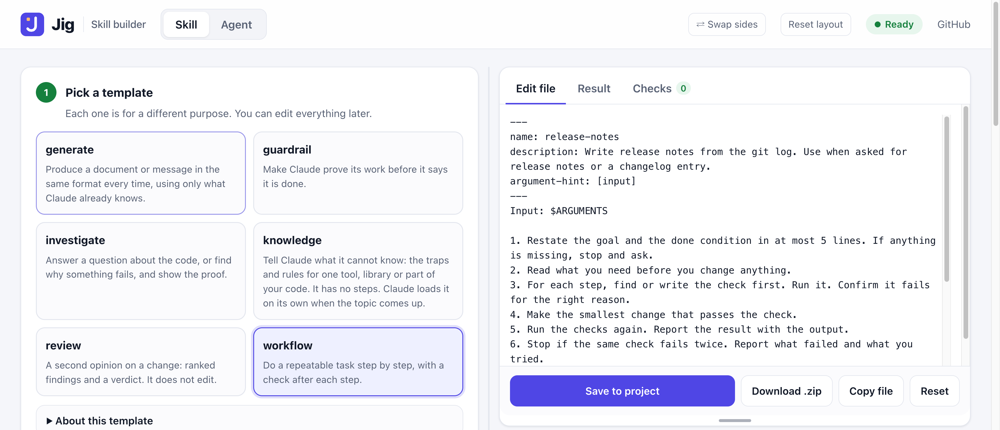
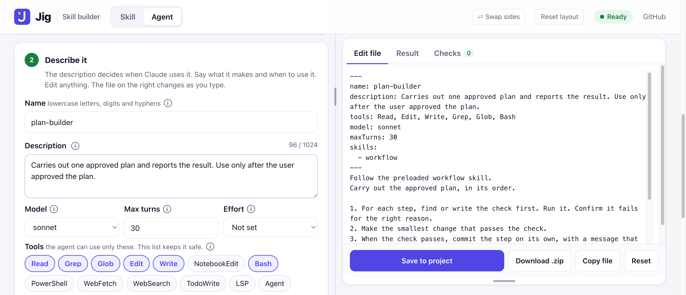
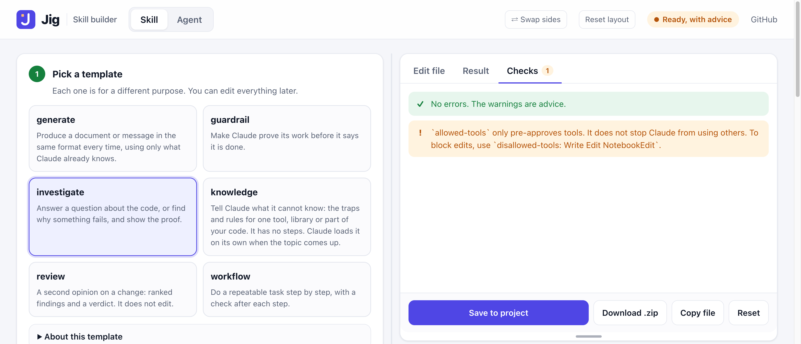
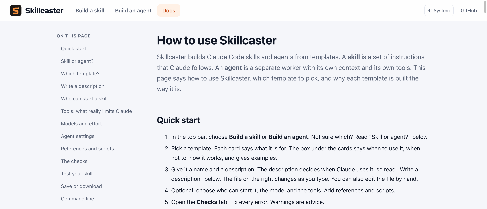
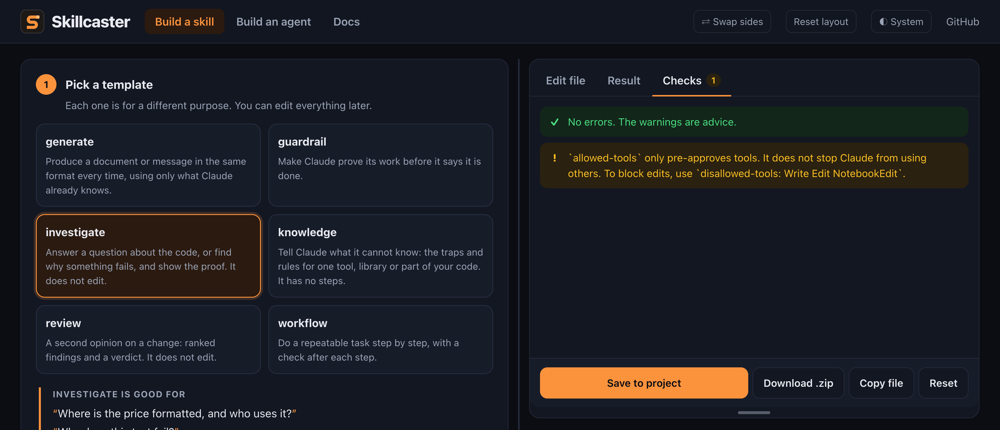

<p align="center">
  <picture>
    <source media="(prefers-color-scheme: dark)" srcset="public/brand/logo-light.svg">
    
  </picture>
</p>

<p align="center"><b>Skill builder for Claude Code.</b><br>
Pick a template, fill in a few lines, check it, and save a skill or an agent.<br>
A web page, a command line, 6 skill templates and 5 agent templates.</p>

<p align="center">
  <a href="LICENSE"></a>
  
  
</p>

<p align="center">
  
</p>

## Quick start

```bash
git clone https://github.com/YaroslavMatushevych/skillcaster ~/skillcaster
cd ~/your-project
node ~/skillcaster/scripts/ui.mjs
```

The page opens in your browser. It saves into `.claude/skills` or `.claude/agents` in the folder where you ran the command. You need Node 18 or newer. There is nothing to install.

**Why "Skillcaster".** You cast a piece by pouring metal into a mold, and every piece has the same shape. The templates are the molds. You pour your task into one and get a skill or an agent in a fixed, checked shape.

## Example: a release-notes skill in five steps

1. Run `node ~/skillcaster/scripts/ui.mjs` in your project. Choose **Build a skill**.
2. Pick `workflow`. The box under the cards says it is for a task you repeat in the same order, and that a check follows every step.
3. Name it `release-notes`. Write the description: `Write release notes from the git log since the last tag. Use when asked for release notes or a changelog entry.`
4. In the file on the right, replace steps 2 to 4 with your own: read `git log` since the last tag, group the commits, write the entry into `CHANGELOG.md`. Keep the check after each step.
5. Open the **Checks** tab. When there are no errors, press **Save to project**. In Claude Code, type `/release-notes`.

The result is a plain file at `.claude/skills/release-notes/SKILL.md`. You can edit it by hand at any time.

## What it looks like

<table>
  <tr>
    <td width="50%"></td>
    <td width="50%"></td>
  </tr>
  <tr>
    <td><b>Agents too.</b> Choose the model, the tools and the skills it follows from a list.</td>
    <td><b>Checks as you type.</b> This one catches a common trap: <code>allowed-tools</code> does not block anything.</td>
  </tr>
  <tr>
    <td width="50%"></td>
    <td width="50%"></td>
  </tr>
  <tr>
    <td><b>A Docs page.</b> How to use it, what to pick when, and why each template is built the way it is.</td>
    <td><b>Light and dark.</b> Follows your computer, or choose one. Panels can be resized and swapped.</td>
  </tr>
</table>

## What do you want to build?

Start here. Find your situation, then use the template.

| Your situation | Build this | Template |
|---|---|---|
| I do the same task in the same order every time. Release, ticket to pull request, dependency update. | A skill | [`workflow`](templates/workflow/) |
| I keep asking "where is X?", "how does Y work?", "why does Z fail?" | A skill, or a cheap agent | [`investigate`](templates/investigate/) or [`explorer`](agent-templates/explorer/) |
| I want a plan, a spec, a summary or a pull request description in the same format every time. | A skill | [`generate`](templates/generate/) |
| I want a second opinion before merge. | A skill, or a read-only agent | [`review`](templates/review/) or [`reviewer`](agent-templates/reviewer/) |
| Claude makes the same mistake with our date library, API or build tool. | A skill | [`knowledge`](templates/knowledge/) |
| Claude says "done" without running the tests. | A skill | [`guardrail`](templates/guardrail/) |
| I want to approve the approach before any code is written. | An agent | [`planner`](agent-templates/planner/) |
| I want an approved plan built without watching every step. | An agent | [`implementer`](agent-templates/implementer/) |
| I want tests written before the code. | An agent | [`tester`](agent-templates/tester/) |

**Skill or agent?** A skill is a procedure that Claude follows inside your session. An agent is a separate worker with its own context and its own tool list. Use a skill for "how to do this". Use an agent when the work is large, or when it must not be able to change anything. An agent can follow a skill: name it in the agent's `skills:` line.

A common chain: `explorer` finds the code, `planner` writes a plan, you approve it, `tester` writes the failing tests, `implementer` builds it, `reviewer` checks it.

## Skill templates

| Template | Purpose | Use it when |
|---|---|---|
| [`workflow`](templates/workflow/) | Do a repeatable task in fixed steps, with a check on each step. | You repeat the same task. |
| [`investigate`](templates/investigate/) | Answer "where", "how" or "why" with proof, without editing. | You need an answer with evidence. |
| [`generate`](templates/generate/) | Make an output in a fixed shape from known facts. You start it. | You want the same format every time. |
| [`review`](templates/review/) | Ranked findings and a verdict, without editing. | You want a review before merge. |
| [`knowledge`](templates/knowledge/) | Your traps and rules for one tool, library or area. No steps. | Claude repeats a mistake with it. |
| [`guardrail`](templates/guardrail/) | One rule to follow before a claim or an action. | Claude skips a step when in a hurry. |

`knowledge` is a skeleton: headings with a guidance comment under each one. You fill it with your own traps and rules, and the check warns until you do. [`docs/example-knowledge.md`](docs/example-knowledge.md) is a filled-in example. The other five work as they are.

## Agent templates

| Template | Tools | Model | Use it when |
|---|---|---|---|
| [`explorer`](agent-templates/explorer/) | Read, Grep, Glob | haiku | You need the right files before you answer or plan. Searching is cheap work. |
| [`planner`](agent-templates/planner/) | Read, Grep, Glob | sonnet | A change touches more than one file and you want to approve a plan first. |
| [`implementer`](agent-templates/implementer/) | Read, Edit, Write, Grep, Glob, Bash | sonnet | A plan is approved. It is the only template that can edit. |
| [`reviewer`](agent-templates/reviewer/) | Read, Grep, Glob | sonnet | You want a review that cannot change anything. You pass it the diff. |
| [`tester`](agent-templates/tester/) | Read, Edit, Write, Grep, Glob, Bash | sonnet | You have acceptance criteria and want failing tests first. |

Every template has an `INSTRUCTIONS.md` with the same parts: **Purpose**, **Use when**, **Do not use when**, **Examples**, **How it works**, **Change**, **Keep** and **Test**. **Change** names the exact lines to edit and gives an example. **Keep** says what to leave alone and why. **Test** says what to run and what a pass looks like. The builder shows the first five under the cards. The Docs page explains when to use each template and why.

## What you can set

The builder writes the real settings from the Claude Code docs. They sit in a block at the top of the file, called frontmatter. It checks every value. It also warns about a setting name it does not know, because Claude Code ignores a misspelled setting without telling you.

**Skill.** Who can start it, as three modes:

| Mode | You can type `/name` | Claude loads it on its own | Field |
|---|---|---|---|
| You or Claude | yes | yes | none (the default) |
| Only you | yes | no | `disable-model-invocation: true` |
| Only Claude | no, it is hidden from the menu | yes | `user-invocable: false` |

Also: `model`, `effort`, `context: fork` with `agent`, `allowed-tools` (no permission prompt for these), `disallowed-tools` (blocked), `when_to_use`, `argument-hint`, `arguments`, `paths`.

**Agent.** `tools`, `disallowedTools`, `model`, `maxTurns`, `effort`, `permissionMode`, `memory`, `isolation: worktree`, `background`, `color`, `mcpServers`, and `skills`.

**Tools** you can pick: Read, Grep, Glob, Edit, Write, NotebookEdit, Bash, PowerShell, WebFetch, WebSearch, TodoWrite, LSP, Agent, Skill, and any other name or MCP tool (`mcp__server__*`). **Models:** haiku, sonnet, opus, fable, inherit, or a full model ID.

Not in the form, so edit the file: `hooks`, `shell`, `initialPrompt`, `omitClaudeMd`, `autoCompactWindow`, `metadata`, `license`, `compatibility`.

## Build with the UI

`node scripts/ui.mjs` (add `--dir <project>` to build for another folder, `--port <n>` to change the port).

1. Choose **Build a skill** or **Build an agent** in the top bar. Pick a template. The page shows when to use it and what to change.
2. Give it a name and a description. The draft updates as you type, and you can edit the whole file. For a skill, set who starts it (Claude, or only you with `/name`), the model, whether it runs in its own context, and which tools are blocked. For an agent, set the model, max turns, the tools, and the skills it follows. Pick those from a list: the skill templates, the skills already in your project, or any name you add.
3. For a skill, add references and scripts. A reference is pasted text, a URL, or a file from your project. You must say when Claude should read it. 
4. The checks update as you work. Save to your project, or download a zip, when there are no errors.

The panels are movable. Drag the divider between the form and the preview to change their widths. Drag the handle at the bottom of the preview to change the height of the Edit file box. **Swap sides** puts the preview on the other side. Arrow keys work on both handles, a double-click resets one, and **Reset layout** resets all. The browser remembers your layout.

The server listens on `127.0.0.1` only, refuses requests from other sites, and writes only inside the project folder.

## Deploy the UI

The UI also runs as a hosted app, for example on Vercel. In hosted mode the app writes nothing to a disk and reads no local files. You get a **Download .zip** with the right folders (`.claude/skills/<name>/...`) that you unzip in your project.

1. Import this repo in Vercel. Framework preset: **Other**. Leave the build command empty. `vercel.json` already sets the output folder (`public`), bundles the templates into the functions, and adds security headers.
2. Or from a terminal: `npx vercel` for a preview, `npx vercel --prod` for production.

What changes in hosted mode:

- No "Save to project" and no "file in the project" reference. Use Download and pasted text.
- The browser downloads URL references, not the server. A site that blocks browser downloads needs pasted text.
- Limits: 10 references, 5 scripts, 300 KB per file, 1 MB per request.
- The API accepts requests from its own origin only.

The hosted code path is covered by tests and was run locally with the real API functions. I have not deployed it to Vercel myself.

## Build with the command line

| Command | What it does |
|---|---|
| `templates [skill\|agent]` | Lists the templates. |
| `new <name> --template <t>` | Creates a skill from a template. Add `--description "..."`, `--dir <folder>`. |
| `new-agent <name> --template <t>` | Creates an agent. Add `--skill <name>`, `--model <m>`, `--tools "Read, Grep"`, `--max-turns <n>`. |
| `add-reference <skill> <file-or-url> --when "..."` | Adds a reference and a line that says when to read it. Adds a table of contents to a long file. |
| `add-script <skill> <file>` | Adds a script and a line that says to run it, not read it. |
| `check <skill-folder-or-agent-file>` | Checks the name, description, length, pointers, tools and model. |

All run as `node scripts/skill.mjs <command>`.

## Let Claude build it

Clone this repo to `~/skillcaster`. Then add this entry to your `CLAUDE.md`, next to your other topics:

```markdown
<topic-index root="~/skillcaster">
Read the referenced file before you start.
<topic name="building" file="BUILDING.md">
When creating or changing a skill or an agent.
Never write the file by hand.
</topic>
</topic-index>
```

The steps are in [BUILDING.md](BUILDING.md). Your `CLAUDE.md` stays short, and the steps live in one place.

Then ask: "Create a skill that writes release notes from the git log."

## Traps this repo already handles

Each of these was tested, and `check` warns about them.

- **`allowed-tools` in a skill does not restrict anything.** It only pre-approves tools. A skill with `allowed-tools: Read Grep Glob` still wrote a file. To block edits use `disallowed-tools: Write Edit NotebookEdit`. A shell command can still write a file, so for a hard guarantee use an agent.
- **A plain `tools:` list in an agent is enforced.** An agent with `tools: Read, Grep, Glob` has no Write and no Bash.
- **A pattern inside an agent's `tools:` does not limit the tool.** An agent with `Bash(git log *)` still ran `ls -la`. Use the plain name, and know that it allows every use of it.
- **A skill with `disable-model-invocation: true` cannot be loaded into an agent.** `generate` is one of these.
- **A vague pointer means Claude never opens the file.** That is why `add-reference` asks you to say when to read it.

## Test

```bash
npm test
```

The checklist for a good skill is in [`docs/checklist.md`](docs/checklist.md). MIT license.
